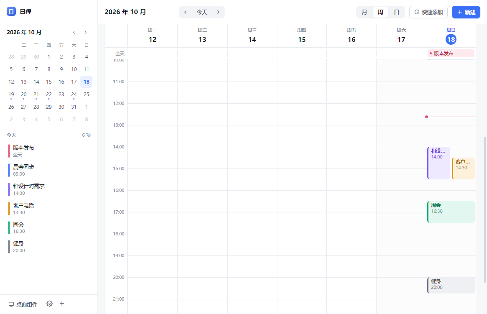
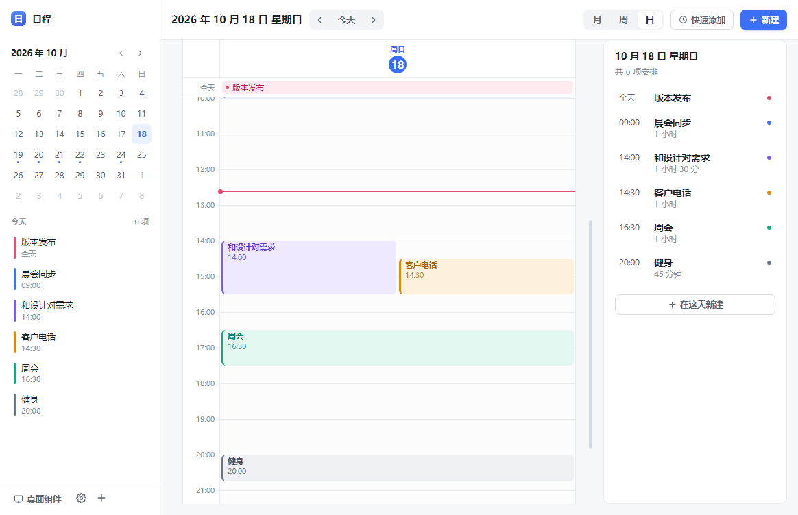

# 日程

一个常驻托盘的 Windows 桌面日程软件。月 / 周 / 日三种视图，一个贴在桌面上的悬浮小窗，数据全部存在本机。


| 周视图 | 日视图 |
| --- | --- |
|  |  |

| 桌面悬浮窗 | 快速添加 |
| --- | --- |
|  |  |

## 功能

**三种视图**

- **月视图**：固定 6×7 网格，每格按可用高度自动显示 N 条事件，超出部分折叠为「还有 X 项」
- **周视图**：7 列 × 24 小时时间轴，重叠的事件自动并排分栏，当前时间有红线指示
- **日视图**：单列时间轴 + 右侧当日详情面板

**记一条日程的成本要足够低**

- `Ctrl + K` 打开快速添加，直接输入 `明天下午3点 和设计对需求 1小时`，回车即存
- 支持 `今天/明天/后天`、`周五/下周一`、`10/20`、`下午3点/14:30/晚上八点半`、`2小时/30分钟`
- 解析结果实时预览，认不出来就退回到完整表单，不会丢输入

**桌面悬浮窗**

- 无边框透明小卡片，显示今天的所有安排，进行中的那条会高亮并带呼吸圆点
- 拖动标题栏移动位置，位置会被记住
- 可折叠成一行、可调背景透明度、可置顶
- 点任意一条直接跳到主窗口的编辑框

**托盘常驻**

- 关闭窗口默认隐藏到托盘（可在设置里改），`Ctrl + Alt + N` 全局唤起新建
- 托盘菜单可开关开机自启、打开数据文件夹

## 快速开始

```bash
npm install
npm run dev        # 开发模式（热更新）
npm run build      # 构建
npm start          # 用构建产物启动
npm run dist       # 打包成 Windows 安装包 → release/
```

`npm run dist` 会生成 `release/日程 Setup x.x.x.exe`（NSIS 安装包，可自选安装目录）。

## 快捷键

| 快捷键 | 作用 |
| --- | --- |
| `Ctrl + K` | 快速添加（自然语言） |
| `N` | 新建日程 |
| `T` | 回到今天 |
| `1` / `2` / `3` | 切换 月 / 周 / 日 视图 |
| `←` / `→` | 上一页 / 下一页 |
| `Ctrl + Enter` | 在编辑框里保存 |
| `Esc` | 关闭弹窗 |
| `Ctrl + Alt + N` | 全局：唤起新建（应用在托盘也生效） |
| `Ctrl + Alt + D` | 全局：显示 / 隐藏桌面悬浮窗 |

## 数据

所有数据保存在本机，不上传任何服务器：

```
%APPDATA%\daily-list\daily-list.json
```

写入采用「临时文件 + rename」的原子写，程序崩溃不会产生半截文件。如果文件被外部破坏，启动时会自动备份为 `daily-list.json.corrupt-<时间戳>.bak` 并重置，不会白屏。

数据结构按**多设备同步**预留了字段：每条事件带 `id` / `rev` / `updatedAt` / `deleted`（软删除墓碑），顶层带 `schemaVersion`。将来接云同步时不需要做数据迁移。

> 云同步目前**没有实现**。账号体系、冲突合并、离线队列是独立的一期工程，强行塞进 MVP 会拖垮稳定性，所以这一版先只做本地。

## 项目结构

```
src/
├── main/              # 主进程
│   ├── index.ts       # 窗口、托盘、悬浮窗、IPC、全局快捷键
│   └── store.ts       # JSON 存储（原子写 + 损坏自愈）
├── preload/           # contextBridge 暴露的 API
├── shared/            # 主进程与渲染进程共用的类型、默认值、配色
└── renderer/
    ├── index.html     # 主窗口
    ├── widget.html    # 悬浮窗（独立渲染进程）
    └── src/
        ├── lib/date.ts      # 日期工具 + 重叠事件分栏算法 layoutDay()
        ├── lib/parse.ts     # 自然语言快速添加解析
        └── components/      # MonthView / TimeGrid / EventEditor / ...
scripts/
├── gen-icon.mjs       # 纯 Node 生成应用图标（无第三方依赖）
├── smoke.mjs          # 冒烟测试：启动应用 + CDP 截图
└── probe.mjs          # 在运行中的渲染进程里执行 JS 做断言
```

## 测试

```bash
npm run typecheck    # 类型检查
node scripts/smoke.mjs   # 启动真实应用，截图到 smoke/
node scripts/probe.mjs "document.querySelectorAll('.month-cell').length"   # 应为 42
```

## 已知限制

- 暂不支持重复日程（每周固定会议需要手动建）
- 暂不支持系统通知提醒
- 暂不支持拖拽调整事件时间
- 云同步未实现（字段已预留）
- 仅针对 Windows 打包配置；Electron 本身跨平台，macOS / Linux 需自行补打包配置
