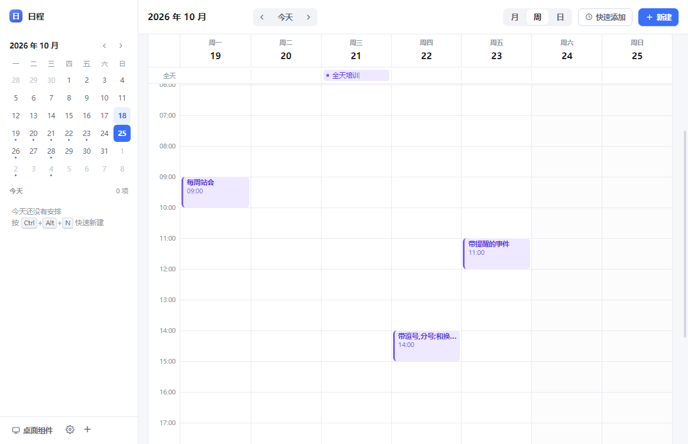
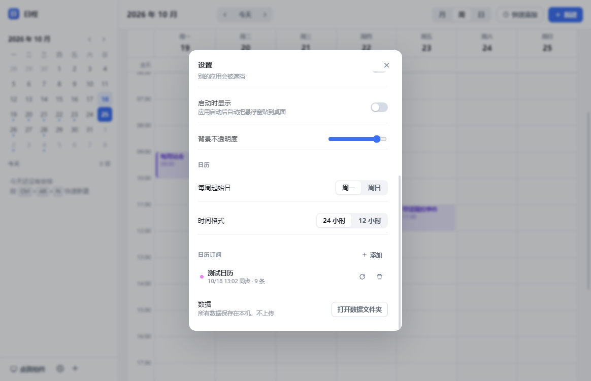
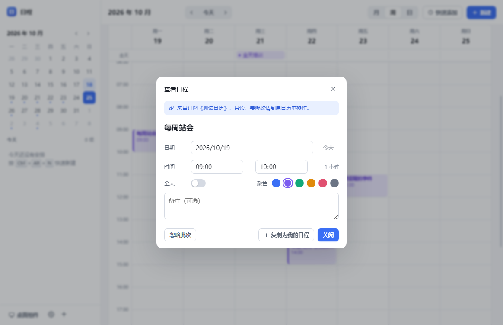
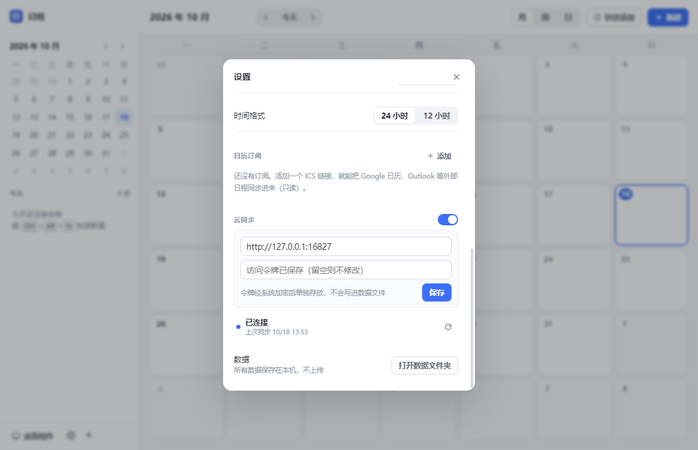

<div align="center">


# 鲨鱼日程

**把安排记下来，把注意力留给眼前。**

一款常驻托盘的 Windows 桌面日程应用。<br />
用一句话记录安排，在月、周、日之间切换，让今天的计划留在桌面上。

<p>
  
  
  <a href="LICENSE"></a>
</p>

[界面预览](#界面预览) · [功能亮点](#功能亮点) · [开始使用](#开始使用) · [开发指南](#开发指南) · [更新日志](CHANGELOG.md)

<br />


<sub>月 / 周 / 日视图 · 自然语言输入 · 桌面悬浮窗 · ICS 订阅 · 可选云同步</sub>

</div>

<br />

## 功能亮点

| | 用起来是什么样 |
| :--- | :--- |
| **📅 三种视图** | 月视图看全局，周视图排时间，日视图专注当天；重叠事件自动并排显示。 |
| **⌨️ 一句话添加** | 按下 `Ctrl + K`，输入「明天下午3点 和设计对需求 1小时」，预览后回车保存。 |
| **🪟 桌面悬浮窗** | 今天的安排贴在桌面上，可拖动、折叠、调透明度，也可以一键置顶。 |
| **🦈 托盘常驻** | 关闭窗口后默认留在托盘；支持开机自启和全局快捷键，随时唤起。 |
| **🔗 日历订阅** | 通过 ICS 链接订阅 Google、Outlook、Apple 等日历，支持重复事件与手动刷新。 |
| **☁️ 可选云同步** | 本地日程可在多台设备间同步，服务端自行部署；不开启也能正常使用本地功能。 |

## 界面预览

### 从整周安排，到今天要做的事

<table>
  <tr>
    <td width="50%" align="center"><strong>周视图</strong><br /><sub>把会议、工作和休息排进时间轴</sub></td>
    <td width="50%" align="center"><strong>日视图</strong><br /><sub>专注今天，查看当天事件详情</sub></td>
  </tr>
  <tr>
    <td></td>
    <td></td>
  </tr>
</table>

### 记得快，也看得见

<table>
  <tr>
    <td width="68%" align="center"><strong>自然语言快速添加</strong><br /><sub>一句话输入，保存前确认解析结果</sub></td>
    <td width="32%" align="center"><strong>桌面悬浮窗</strong><br /><sub>今天的计划，抬眼就能看到</sub></td>
  </tr>
  <tr>
    <td align="center"></td>
    <td align="center"></td>
  </tr>
</table>

<details>
<summary><strong>展开查看：日历订阅与云同步设置</strong></summary>

<br />

| 添加日历订阅 | 管理订阅源 |
| :---: | :---: |
|  |  |

| 查看订阅事件 | 配置云同步 |
| :---: | :---: |
|  |  |

</details>

## 开始使用

### 安装 Windows 版本

前往 [Releases](https://github.com/ChadBi/shark-calendar/releases) 查看安装包，下载 `鲨鱼日程 Setup x.x.x.exe` 并按提示安装，可自行选择安装目录。

> [!NOTE]
> 如果 Releases 尚无安装包，可以按下方[开发指南](#开发指南)从源码运行或自行打包。当前打包目标为 **Windows x64**。

### 试着记下第一条安排

打开应用，按 `Ctrl + K`，输入：

```text
明天下午3点 和设计对需求 1小时
```

确认时间与标题，回车保存。也可以使用这些表达：

| 想表达的内容 | 支持的写法 |
| :--- | :--- |
| 日期 | `今天`、`明天`、`后天`、`周五`、`下周一`、`10/20` |
| 时间 | `下午3点`、`14:30`、`晚上八点半` |
| 时长 | `1小时`、`2小时`、`30分钟` |

需要更多字段时，点击「新建」打开完整表单。

### 把今天的计划放到桌面

点击侧边栏底部的「桌面组件」，或按 `Ctrl + Alt + D` 显示悬浮窗。拖动标题栏调整位置，点击事件可回到主窗口查看。

悬浮窗默认不置顶；需要常驻最前时，点击图钉按钮。位置、透明度和置顶设置会保存在本机。

### 接入其他日历与设备

- **订阅日历**：在设置中添加 `https://...` 或 `webcal://...` 格式的 ICS 链接。启动时自动刷新，之后每 6 小时刷新一次，也可手动刷新；失败时保留上次的数据。
- **多设备同步**：按[云同步部署指南](docs/cloud-sync-setup.md)部署服务，然后在各设备填写相同的服务地址与令牌。仅同步本地创建的事件，订阅源和窗口设置由各设备分别维护。

订阅事件为只读，可「忽略此次」或「复制为我的事件」；修改原始内容需回到来源日历操作。

<details>
<summary><strong>展开查看：常用快捷键</strong></summary>

| 快捷键 | 作用 |
| :--- | :--- |
| `Ctrl + K` | 打开自然语言快速添加 |
| `N` | 新建事件 |
| `T` | 回到今天 |
| `1` / `2` / `3` | 切换月 / 周 / 日视图 |
| `←` / `→` | 上一个 / 下一个时间区间 |
| `Ctrl + Enter` | 在事件编辑框中保存 |
| `Esc` | 关闭编辑框或设置面板 |
| `Ctrl + Alt + N` | 全局唤起新建事件 |
| `Ctrl + Alt + D` | 全局显示 / 隐藏桌面悬浮窗 |

单字母和方向键快捷键用于主界面浏览；输入文字时不会触发。

</details>

## 数据与隐私

日程默认保存在本机，**云同步默认关闭**。启用后，本地创建的日程会上传到你配置的服务器；ICS 订阅会向你配置的日历地址请求数据。

```text
%APPDATA%\daily-list\
├── daily-list.json    # 日程、订阅源和应用设置
└── sync-token.bin     # 单独存放的同步令牌
```

- **本地存储**：采用「临时文件 + rename」写入；检测到损坏的数据文件时，会先备份再重置。
- **同步令牌**：系统支持加密时使用 Electron `safeStorage`（Windows DPAPI）；不支持加密时会降级为明文存储。
- **同步冲突**：同一事件按修改时间取较新版本；删除操作同步到其他设备，避免旧记录重新出现。

备份日程时可先退出应用，再复制 `daily-list.json`。其中可能包含私人日程和订阅链接，请妥善保管；`sync-token.bin` 也不应公开。更换设备后，请重新配置同步令牌。

## 开发指南

基于 **Electron 33 · React 18 · TypeScript 5.7 · electron-vite**，使用 Zustand 管理界面状态，date-fns 处理日期，rrule 展开订阅中的重复事件。

准备 Windows 开发环境、Git、Node.js 22 或更高版本及 npm，然后运行：

```bash
git clone https://github.com/ChadBi/shark-calendar.git
cd shark-calendar
npm ci
npm run dev
```

### 构建与打包

| 命令 | 作用 |
| :--- | :--- |
| `npm run dev` | 启动开发模式，支持热更新 |
| `npm run typecheck` | 运行 TypeScript 类型检查 |
| `npm run build` | 构建到 `out/` |
| `npm start` | 启动已构建的应用 |
| `npm run dist:dir` | 生成可直接运行的 Windows 应用目录 |
| `npm run dist` | 生成 Windows NSIS 安装包 |

当前打包输出为 `release-v8/`，由 `package.json` 中的 `build.directories.output` 配置。安装包通过 GitHub Releases 单独发布，依赖、构建产物、测试数据和本地凭据不纳入源码仓库。

<details>
<summary><strong>项目结构</strong></summary>

```text
src/
├── main/                    # Electron 主进程
│   ├── index.ts             # 窗口、托盘、IPC 与全局快捷键
│   ├── store.ts             # 本地 JSON 存储与数据迁移
│   ├── ics.ts               # ICS 解析与重复事件展开
│   ├── sync.ts              # 日历订阅刷新
│   ├── cloud-sync.ts        # 多设备同步
│   └── credentials.ts       # 同步令牌存储
├── preload/                 # contextBridge API
├── shared/                  # 共用类型与默认配置
└── renderer/                # React 主界面与桌面悬浮窗
    └── src/
        ├── components/      # 日历视图、事件编辑与设置
        ├── lib/             # 日期工具与自然语言解析
        └── styles/          # 主窗口与悬浮窗样式
cloudbase/functions/sync/    # CloudBase 同步云函数模板
docs/                       # 部署文档
resources/                  # 主图标与托盘图标
screenshots/                # 界面演示截图
scripts/                    # 图标工具、测试与验证脚本
```

内部标识 `package.json` 的 `name` 保持为 `daily-list`，以沿用现有用户数据目录；显示名称由 `build.productName` 配置。

</details>

<details>
<summary><strong>测试与联调</strong></summary>

先运行 `npm run build`，再按需使用以下脚本：

```bash
npm run typecheck
npm run smoke
node scripts/probe.mjs "document.querySelectorAll('.month-cell').length"
node scripts/test-subscribe.mjs
node scripts/test-migrate.mjs
node scripts/test-edge.mjs
node scripts/test-sync.mjs
```

冒烟测试启动真实 Electron 应用，截图与隔离测试数据写入 `smoke/`；月视图格数检查的预期结果为 `42`。

打包版检查需先运行 `npm run dist:dir`：

```bash
node scripts/qa-packaged.mjs
node scripts/verify-packed.mjs https://your-sync-server.example
```

同步服务地址必须自行传入，不带末尾 `/sync`。

</details>

<details>
<summary><strong>更换应用图标</strong></summary>

准备方形图片（PNG / JPG，建议至少 256 × 256），运行：

```bash
node scripts/update-icon.mjs path/to/your-icon.png
npm run dist
```

图片转换与托盘缩略图生成需要 Python 和 Pillow：

```bash
python -m pip install Pillow
```

脚本从 PATH 查找解释器，也支持通过 `PYTHON` 环境变量指定 Python 可执行文件。原图副本保存在 `resources/icon-source.*`，主图标为 `resources/icon.png`，托盘图标为 `resources/tray.png`。

</details>

## 当前边界

| 能力 | 当前状态 |
| :--- | :--- |
| 本地重复事件 | 暂不支持；订阅日历中的重复事件可以展开 |
| 系统通知提醒 | 暂不支持 |
| 拖拽调整事件时间 | 暂不支持 |
| 订阅事件编辑 | 只读，可忽略单次或复制为本地事件 |
| 订阅展开范围 | 过去 60 天至未来 365 天，单源上限 3000 条实例 |
| 云同步 | 客户端与服务端模板已提供，需要自行部署服务 |
| macOS / Linux | 尚未提供打包配置 |

## 反馈与参与

欢迎通过 [Issues](https://github.com/ChadBi/shark-calendar/issues) 反馈问题或提出建议，也欢迎提交 Pull Request。报告问题时，请附上应用版本、复现步骤和必要截图，并隐去私人日程、订阅链接与访问令牌。

项目采用 [MIT 许可证](LICENSE)；版本变更见 [CHANGELOG](CHANGELOG.md)。

<div align="center">

<br />

<br />
<sub>鲨鱼日程 · 让今天的安排，各就各位。</sub>

</div>
